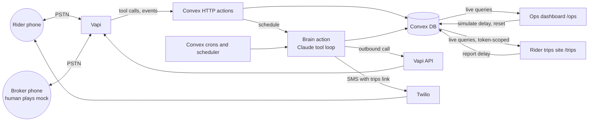
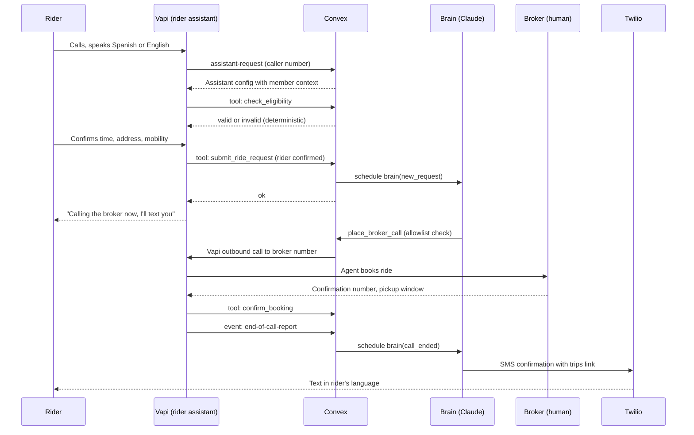
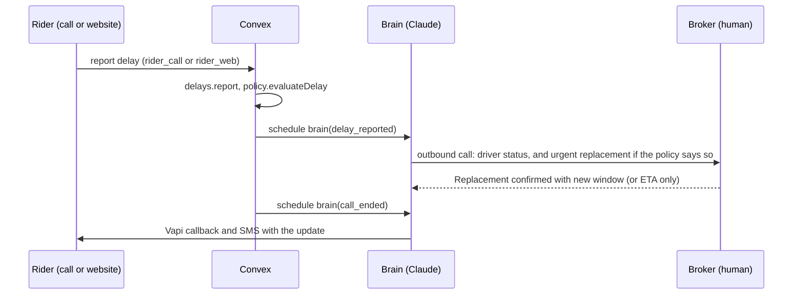
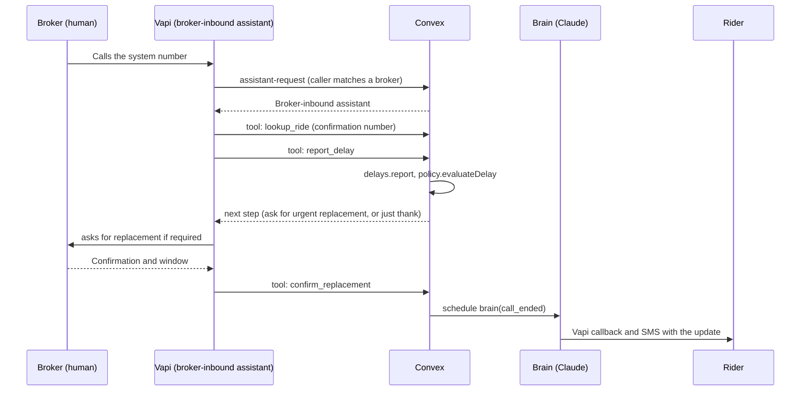

# 02 - Architecture

> **Superseded in part (2026-10-24):** voice moved from Vapi to **Cartesia Managed Agents**, and SMS is off for now. Mapping: `/vapi/server` became `POST /voice/tools/<name>` (webhook tools, bearer secret) and `POST /voice/events` (call events, `X-Webhook-Secret`); `assistant-request` routing became the `identify_caller` tool, the first thing the single `inbound-assistant` calls; the rider and broker-inbound assistants are one agent on the one free number; `report_delay` is split into `report_delay_rider` and `report_delay_broker`; rider updates go by callback instead of SMS. See `10-OPEN-DECISIONS.md` and `convex/lib/voiceAgents.ts`.

## 1. Principle

Convex is the single backend. Vapi handles real-time voice; Convex handles everything else: state, webhooks, scheduling, orchestration, and the live dashboard. The Claude "brain" runs asynchronously inside Convex actions so the live voice path stays fast.

## 2. Components

| Component | Responsibility |
|---|---|
| Vapi rider assistant | Inbound conversation, Cartesia voice, Haiku for turns, calls tools (book or report a delay) |
| Vapi broker-caller assistant | Outbound call to the broker number; parameterized per call with ride details and mode |
| Vapi broker-inbound assistant | Answers when a broker calls in to report a delay or confirm a replacement |
| Convex HTTP actions | Receive Vapi tool calls and server events; route inbound callers; verify secret; write DB; schedule work |
| Convex brain (actions) | Claude tool loop that decides next steps, places calls, sends SMS |
| Convex scheduler and crons | Brain runs, expiration scans |
| Convex DB and live queries | Source of truth and feed for both web apps |
| Twilio | Outbound SMS only |
| Ops dashboard (`/ops`) | Live ride board, transcripts, decision log, delay reports, demo controls |
| Rider trips site (`/trips`) | Token-gated view of the rider's upcoming, current, and past trips, with a "My driver is late" button |

## 3. Why the voice path and brain are separate

Vapi needs tool responses fast. The rider assistant only does a few things synchronously: identify, check eligibility (a deterministic function), save the confirmed request, and record a delay report (whose policy evaluation is also a pure, fast function). Everything that involves calling a broker or composing a plan happens after, asynchronously, in the brain. The rider is told "I'll call the broker now and text you."

## 4. Flow A: booking

## 5. Delay reporting and recovery

### Delay report channels

Every channel ends in the same function, `delays.report`, which runs the deterministic `policy.evaluateDelay` and stores who reported it.

| Channel | Reporter | Entry point |
|---|---|---|
| `rider_call` | Rider | Rider assistant tool `report_delay` during an inbound call |
| `rider_web` | Rider | "My driver is late" on the trips website (`portal.reportDelay`) |
| `broker_call` | Broker | Broker calls the system number; `assistant-request` recognizes the broker's number and routes to the broker-inbound assistant, whose tool `report_delay` records it. Also possible during a call the agent places |
| `ops_dashboard` | Either (simulated) | `demo.simulateDelay` for testing and as the demo safety net |

### Flow B1: rider reports

### Flow B2: broker reports

If the broker's report shows the delay is within the threshold, the policy returns `notify_rider_only` and the rider gets a delay update with the new ETA, with no replacement requested.

### Rider website

The trips website reads the same live data. When a delay or replacement is recorded, the trip moves to Current and the status text changes on the rider's screen without refresh.

## 6. Convex features used (target list for the Convex prize)

| Feature | Where |
|---|---|
| Schema with validators and indexes | `convex/schema.ts` |
| Live queries | Ops dashboard (ride board, transcripts, decision log, delay reports) and rider trips website (current trip, lists, timeline) |
| Token-scoped queries and mutations | `portal.*` functions for the rider website |
| Mutations as a transactional state machine | `rides.transition`, `delays.report` |
| HTTP actions | Vapi tool and event webhooks, caller routing |
| Actions calling external APIs | Anthropic, Vapi, Twilio |
| Scheduled functions | `ctx.scheduler.runAfter` for brain runs |
| Cron jobs | Daily paperwork expiration scan (P1) |
| Optional components (verify availability and fit first) | Action retrier, rate limiter, workflow |

The README must state where each is used and why.

## 7. Model routing and cost control

| Task | Model | Notes |
|---|---|---|
| Rider voice turns | Haiku 5.5 (via Vapi) | Speed first |
| Broker-caller voice turns | Haiku 5.5 (via Vapi) | Same |
| Brain decisions and message drafting | Sonnet 5.5 | Short prompts, capped output |
| Call outcome extraction from transcript | Haiku 5.5 | Structured JSON |

Controls: `convex/lib/llm.ts` is the only code that calls Anthropic. It sets `max_tokens`, logs each call to `llmUsage`, enforces a per-ride token budget, and uses prompt caching for the stable system prompt and policy text. Set a hard monthly spend limit in the Anthropic Console. Test logic in text first. Verify current per-token prices in the Console.

## 8. Security and safety boundaries

- Webhooks require `VAPI_WEBHOOK_SECRET` in a header; reject otherwise.
- `ALLOWED_OUTBOUND_NUMBERS` allowlist checked in `convex/lib/safety.ts` before every Vapi outbound call and Twilio SMS.
- Inbound calls are routed by caller number; unknown callers get a polite refusal. Broker caller ID is not proof of identity, so broker-inbound tools return minimal information and can only record delays and replacements.
- Rider website: random token per SMS link, stored hashed, expiring, scoped to one member; every `portal.*` function re-checks it. The website never receives transcripts, the decision log, or other members' data.
- Ops controls (`simulateDelay`, `reset`, `seed`) and the ops dashboard have no login and exist only for the demo; note this in the README.
- No secrets in the repo; Convex env vars only.

## 9. Failure and fallback

| Failure | Fallback |
|---|---|
| Vapi outbound call fails to connect | Brain logs the error, retries once, then shows "needs human" on the dashboard |
| Broker (human) gives unexpected answers | Outcome extraction marks `unclear`; brain asks one follow-up call at most; otherwise flags for human |
| Broker's inbound call is not recognized | Caller is treated as unknown; use the rider or ops delay channel instead |
| Same delay reported twice | Duplicates within a short window are ignored; reports during an open recovery attach to it |
| Replacement ride also delayed | Escalated to a human instead of looping |
| Anthropic call errors or budget exceeded | Fall back to a templated message; log to `agentEvents` |
| Rider website link expired or invalid | Plain message; a new link is texted with the next update |
| Live demo fails | Pre-recorded backup video (see `07-DEMO-SCRIPT.md`) |
