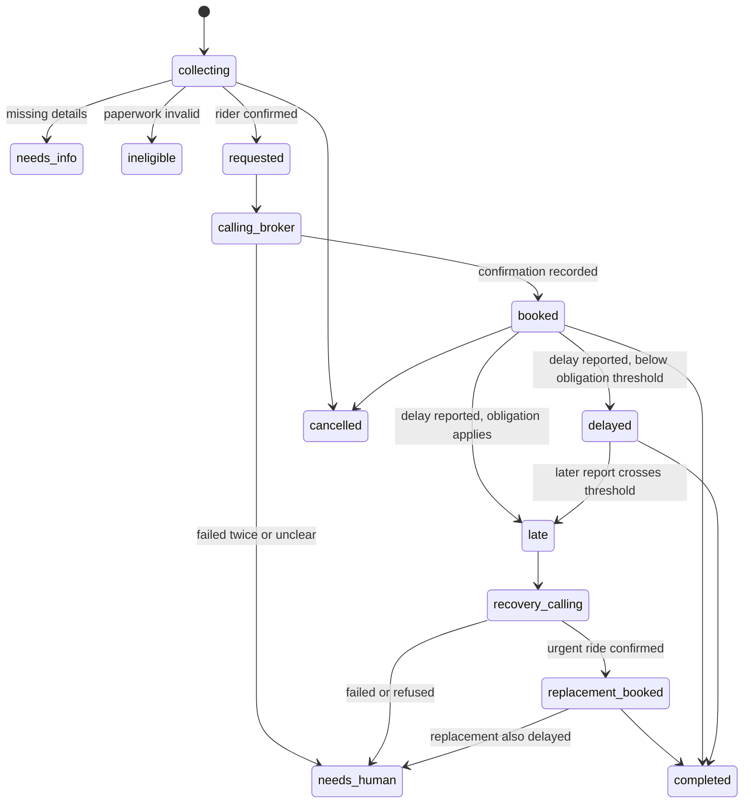

# 03 - Data Model

All data is fake. Timestamps are ms since epoch. Phones are E.164.

## 1. Tables

### members
| Field | Type | Notes |
|---|---|---|
| name | string | Fake |
| phone | string | Caller ID match key |
| preferredLanguage | "en" or "es" | Drives voice, SMS, callback, and website default language |
| medicalId | string | Fake, never real |
| plan | string | e.g. "L.A. Care" (display only) |
| address | string | Default pickup |
| mobility | "ambulatory" or "wheelchair" or "gurney" | Determines NEMT vs NMT |
| rideType | "NEMT" or "NMT" | |
| pcsExpiresAt | number, optional | NEMT paperwork |
| nmtApprovalExpiresAt | number, optional | NMT paperwork |
| agentAuthorizedAt | number, optional | Rider authorized the agent to act |
| caregiverName, caregiverPhone | optional strings | P1 |

Index: `by_phone (phone)`.

### brokers
| Field | Type | Notes |
|---|---|---|
| name | string | e.g. "Call the Car (mock)" |
| plan | string | Matches `members.plan` |
| phone | string | Mock number, must be on the allowlist. **Also the number the system recognizes when a broker calls in** |
| advanceNoticeHours | number | Display and validation |

Indexes: `by_plan (plan)`, `by_phone (phone)`.

### rides
| Field | Type | Notes |
|---|---|---|
| memberId | id members | |
| status | string | See state machine |
| appointmentAt | number | |
| appointmentType | string | e.g. "dialysis" |
| destinationName, destinationAddress | strings | |
| pickupAddress | string | Confirmed by rider |
| mobilitySnapshot | string | Copied from member at request time |
| riderConfirmedAt | number, optional | Required before any booking call |
| brokerId | id brokers, optional | |
| brokerConfirmationNumber | string, optional | |
| pickupWindowStart, pickupWindowEnd | number, optional | |
| estimatedPickupAt | number, optional | Latest known ETA after a delay report |
| firstDelayReportedAt | number, optional | |
| replacementRequestedAt | number, optional | |
| replacementConfirmationNumber | string, optional | |
| replacementWindowStart, replacementWindowEnd | number, optional | |
| completedAt | number, optional | |
| language | "en" or "es" | Language of the rider call |
| needsHuman | boolean | Escalation flag |
| createdAt | number | |

Indexes: `by_member`, `by_status`, `by_confirmation (brokerConfirmationNumber)`.

### delayReports
One row per report, from any source.
| Field | Type | Notes |
|---|---|---|
| rideId | id rides | |
| reportedBy | "rider" or "broker" | Who is claiming the delay |
| channel | "rider_call" or "rider_web" or "broker_call" or "ops_dashboard" | `ops_dashboard` means simulated from demo controls, with `reportedBy` set to the role being simulated |
| callId | id calls, optional | For call channels |
| delayMinutes | number, optional | Minutes past the start of the pickup window |
| newEstimatedPickupAt | number, optional | If the reporter gave an ETA |
| reason | string, optional | |
| note | string, optional | Free text from the rider or broker |
| evaluation | object, optional | Result of `policy.evaluateDelay` (see section 3) |
| handledAt | number, optional | Set when the brain has acted |
| createdAt | number | |

Index: `by_ride (rideId, createdAt)`.

### calls
| Field | Type | Notes |
|---|---|---|
| rideId | id rides, optional | |
| memberId | id members, optional | |
| brokerId | id brokers, optional | For broker calls |
| role | "rider_inbound" or "broker_booking" or "broker_delay" or "broker_inbound" or "rider_callback" | `broker_inbound` = the broker called the system; `broker_delay` = the agent called the broker about a delay |
| direction | "inbound" or "outbound" | |
| intent | string, optional | "book", "report_delay", "status", "broker_report" |
| vapiCallId | string | |
| status | "ringing" or "in_progress" or "ended" or "failed" | |
| language | string, optional | |
| startedAt, endedAt | numbers, optional | |
| summary | string, optional | |
| outcome | object, optional | Structured extraction (see 05) |

Indexes: `by_vapiCallId`, `by_ride`.

### transcriptLines
| Field | Type |
|---|---|
| callId | id calls |
| rideId | id rides, optional |
| speaker | "agent" or "rider" or "broker" |
| text | string |
| ts | number |
| isFinal | boolean |

Index: `by_call (callId, ts)`.

### agentEvents (audit and decision log)
| Field | Type | Notes |
|---|---|---|
| rideId | id rides, optional | |
| kind | "decision" or "tool_call" or "policy_check" or "status_change" or "delay_report" or "sms" or "call" or "error" | |
| summary | string | One line for the ops dashboard |
| payload | any, optional | Details. Never shown to riders |
| riderText | object, optional | `{ en, es }` plain-language line. **Only events with `riderText` appear on the rider website** |
| createdAt | number | |

Index: `by_ride (rideId, createdAt)`.

### messages (SMS)
`rideId`, `memberId`, `to`, `body`, `language`, `twilioSid`, `status`, `createdAt`. Index `by_ride`.

### portalTokens (rider website access)
| Field | Type | Notes |
|---|---|---|
| memberId | id members | A token grants access to one member only |
| tokenHash | string | Hash of the random token. The raw token exists only in the SMS link |
| createdAt, expiresAt | numbers | Lifetime from `PORTAL_TOKEN_TTL_DAYS` |
| lastUsedAt, revokedAt | numbers, optional | |

Index: `by_hash (tokenHash)`.

### llmUsage
`rideId` (optional), `purpose`, `model`, `inputTokens`, `outputTokens`, `cacheReadTokens` (optional), `createdAt`. Index `by_ride`. Used for the per-ride budget check and the cost display.

### demoState (single row)
`activeRideId` (optional), `delayMinutes` (default 20, used by simulated delays), `brokerLine` (current broker number). Lets the ops dashboard control the demo without code changes.

## 2. Ride state machine

Allowed transitions are enforced only by `rides.transition(rideId, to, reason)`. Each transition writes an `agentEvents` row of kind `status_change` that includes `riderText` from the wording table below. A delay report that arrives while the ride is already `late` or `recovery_calling` is logged and attached to the open recovery, not treated as a new one.

### Rider-facing wording (used by the website and SMS)

Website text uses accents. SMS text omits accents (see 05) to stay short and compatible.

| Status | English | Spanish |
|---|---|---|
| requested | We are arranging your ride. | Estamos organizando su transporte. |
| calling_broker | We are contacting the ride company. | Estamos llamando a la empresa de transporte. |
| booked | Your ride is booked. Pickup {{window}}. | Su transporte está reservado. Recogida {{window}}. |
| delayed | Your driver is running late. New estimated pickup {{eta}}. | Su conductor se retrasó. Nueva hora estimada de recogida {{eta}}. |
| late | Your driver is late. We are asking for an urgent replacement ride. | Su conductor se retrasó. Estamos pidiendo otro transporte urgente. |
| recovery_calling | We are arranging a replacement ride now. | Estamos organizando otro transporte ahora. |
| replacement_booked | A replacement ride is on the way. Pickup {{window}}. | Va en camino otro transporte. Recogida {{window}}. |
| needs_human | We need a person to help with this ride. Please call your health plan. | Una persona debe ayudar con este transporte. Llame a su plan de salud. |
| ineligible | We could not book this ride because your paperwork needs renewal. | No pudimos reservar este transporte porque sus documentos necesitan renovación. |
| completed | Trip completed. | Viaje completado. |
| cancelled | Trip cancelled. | Viaje cancelado. |

Have a native Spanish speaker review the Spanish text if you can.

## 3. Policy functions (`convex/lib/policy.ts`)

Pure functions, unit-testable without any API:

| Function | Returns |
|---|---|
| `paperworkStatus(member, appointmentAt)` | `{ valid, kind, expiresAt, reason }`. NEMT checks `pcsExpiresAt`, NMT checks `nmtApprovalExpiresAt`; invalid if missing or expired by the appointment date |
| `daysUntilExpiry(member, now)` | number, used by the 30-day alert |
| `evaluateDelay(ride, report, now)` | `{ action, obligationApplies, minutesPastWindowStart, projectedPickupAt, reasonCode }`. See rules below |
| `urgentRideObligation()` | Static text of the plan obligation used in the broker script (verify wording against the DHCS source) |

### `evaluateDelay` rules

`DRIVER_LATE_THRESHOLD_MINUTES = 15`. **This is a demo assumption.** The 15-minute figure in the DHCS summary is about how early the rider must be ready, not a verified trigger for driver lateness. Check the real trigger before the pitch.

Projected pickup = `newEstimatedPickupAt` if given, else `pickupWindowStart + delayMinutes` if given, else unknown. A rider report with no minutes and no ETA means "the driver has not arrived".

| Order | Condition | Action |
|---|---|---|
| 1 | Ride has no booked pickup window | `reject` (reasonCode `no_booked_ride`) |
| 2 | Ride status is `replacement_booked` | `escalate_to_human` (the replacement is also delayed) |
| 3 | Projected pickup is more than the threshold past `pickupWindowStart` | `request_urgent_replacement` |
| 4 | Rider report, projected pickup unknown, and now is more than the threshold past `pickupWindowStart` | `request_urgent_replacement` |
| 5 | Rider report, projected pickup unknown, and now is within the threshold | `verify_with_broker` (agent asks the broker for driver status; the obligation is not invoked yet) |
| 6 | Anything else (an ETA within the threshold) | `notify_rider_only` |

Duplicate reports from the same channel within 2 minutes are ignored (logged, not re-evaluated).

## 4. Seed data (`demo:seed`)

| Member | Language | Plan | Mobility | Paperwork |
|---|---|---|---|---|
| Maria Gonzalez | es | L.A. Care | wheelchair | PCS valid, expires in about 5 months |
| James Carter | en | CalOptima | ambulatory | NMT approval valid |
| Rosa Delgado | es | L.A. Care | wheelchair | PCS **expired** (use to show the ineligible path) |

Brokers: one per plan, all pointing to the demo broker number. **Phone numbers for the seed members must be numbers you control**, and every number must be in `ALLOWED_OUTBOUND_NUMBERS`.

Seed trips for the rider website: Maria has two `completed` past trips and one `cancelled`; James has one `completed`. The live demo ride is created by the call, so it starts under Upcoming.
